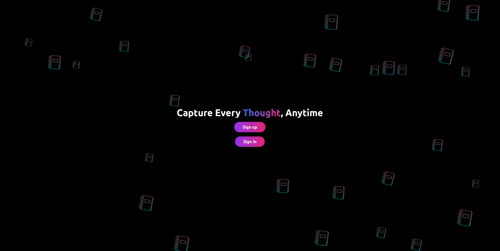
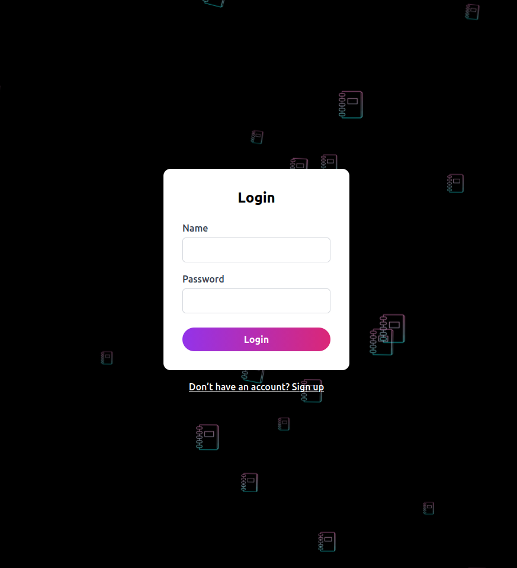
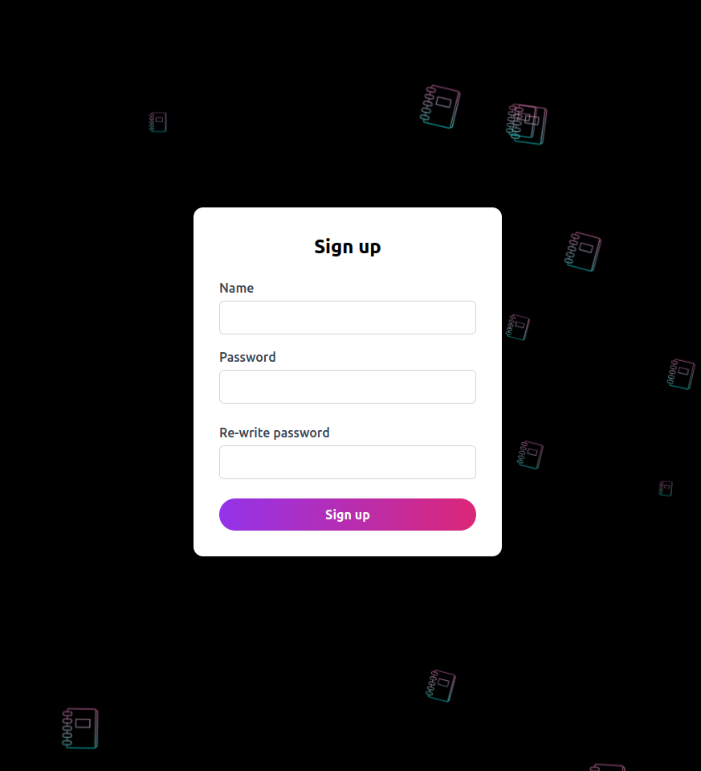
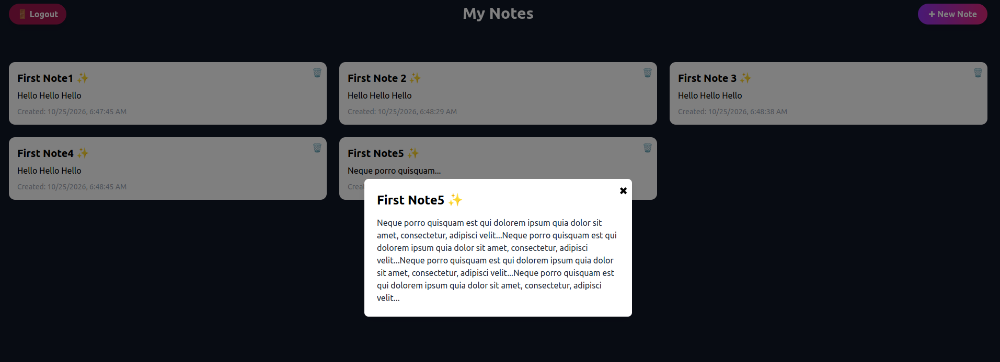

# 📝 Notes App

A full-stack Basic notes application built with **React, NestJS, MongoDB, and Prisma**. Create and manage personal notes, discover public notes, and access administrative features through role-based permissions.

## ✨ Features

### 👤 User Features
- 🔐 User registration and login
- 📝 Create, edit, and delete personal notes
- 🔒 Access control for private notes
- 🔎 Discover public notes from other users (if enabled)
- 📊 Dashboard for managing personal notes

### 🛡️ Administrator Features
- 👥 View registered users
- 📚 View all notes, including private notes
- 🗑️ Delete any note
- 🔑 Role-based access to administrative functionality

### 🔐 Authentication & Authorization
- JWT-based authentication
- Role-Based Access Control (RBAC)
- Password hashing
- Protected API endpoints
- Note ownership and access restrictions

*The security features listed above should be verified against the current implementation.*

## 🖼️ Screenshots

A look at the application's interface.

| Home Page | Sign In |
|:---:|:---:|
|  |  |

| Sign Up | Dashboard |
|:---:|:---:|
|  |  |

> Add your screenshots to the `screenshots/` directory and adjust the filenames if necessary.

## 🧰 Tech Stack

### Frontend
- React
- JavaScript
- CSS

### Backend
- NestJS
- Node.js
- Prisma ORM
- MongoDB

### Authentication
- JSON Web Tokens (JWT)
- Role-Based Access Control (RBAC)

### Development & Infrastructure
- Docker
- Docker Compose
- npm

## 📁 Project Structure

```text
notes/
├── backend/
│   ├── src/
│   ├── prisma/
│   ├── package.json
│   └── README.md
├── frontend/
│   ├── public/
│   ├── src/
│   └── package.json
├── screenshots/
├── docker-compose.yml
├── .gitignore
└── README.md
```

*Your actual folder and file names may differ.*

## 🚀 Getting Started

### Prerequisites

Install the following tools:

- [Node.js](https://nodejs.org/)
- npm
- [Docker](https://www.docker.com/) and Docker Compose
- [Git](https://git-scm.com/)

You can run MongoDB through Docker or use a MongoDB deployment that you already have access to.

### 1. Clone the repository

```bash
git clone <YOUR_REPOSITORY_URL>
cd notes
```

Replace `<YOUR_REPOSITORY_URL>` with your public GitHub repository URL.

### 2. Configure environment variables

Configure the backend and frontend using the environment variables expected by your application.

For the backend, create a local `.env` file containing the appropriate MongoDB connection string and JWT configuration.

Example:

```env
PORT=3000
DATABASE_URL="your_mongodb_connection_string"
JWT_SECRET="your_secure_random_secret"
```

**Important:** `DATABASE_URL` is a placeholder variable name commonly used with Prisma. Confirm that it matches your `backend/prisma/schema.prisma` and application configuration.

Never commit real database credentials, tokens, or secrets.

### 3. Start MongoDB with Docker Compose

From the directory containing `docker-compose.yml`, run:

```bash
docker compose up -d db
```

Check that the container is running:

```bash
docker compose ps
```

The MongoDB container uses persistent storage through the `mongodb_data` volume, so its data can survive container recreation.

Ensure your Docker Compose configuration loads credentials securely from environment variables rather than hardcoding passwords.

### 4. Set up the backend

```bash
cd backend
npm install
```

Generate the Prisma Client:

```bash
npx prisma generate
```

Check the backend's available npm scripts before starting it. For example, a NestJS development server commonly starts with:

```bash
npm run start:dev
```

For MongoDB, Prisma uses its MongoDB connector. Depending on your schema changes and Prisma version, database initialization and schema changes may require `prisma db push` rather than SQL migration commands.

Run database setup only after confirming the configured database URL and intended environment.

### 5. Set up the frontend

Open another terminal:

```bash
cd frontend
npm install
npm start
```

The frontend development server will usually be available at [http://localhost:3000](http://localhost:3000), unless configured otherwise.

Make sure the frontend API URL points to the correct backend address and port.

## 🗄️ Database

This project uses **MongoDB** as its database and **Prisma** to interact with the data layer.

The Docker Compose configuration provides a MongoDB service with:
- MongoDB running in a container
- Configurable database credentials
- Persistent data storage through a named Docker volume

The database schema and models are defined by the Prisma schema in the backend.

## 🔑 Roles & Permissions

| Permission | User | Admin |
|:---|:---:|:---:|
| Manage own notes | ✅ | ✅ |
| Discover public notes | ✅ | ✅ |
| View all users | ❌ | ✅ |
| View all notes | ❌ | ✅ |
| Delete any note | ❌ | ✅ |

Private notes and administrative actions must be protected by backend authorization checks.

## 🛠️ Development

Run the frontend and backend in separate terminals during development.

Useful checks include:

```bash
# Backend
cd backend
npm run
```

```bash
# Frontend
cd frontend
npm run
```

These commands list the scripts available in each project's `package.json`.

Before publishing changes, test registration, login, note ownership, private-note access, and administrative permissions.

## 🗺️ Roadmap

Potential future improvements:

- [ ] Search, filtering, and sorting
- [ ] Responsive UI improvements
- [ ] Automated frontend and backend tests
- [ ] Docker Compose configuration for the complete application
- [ ] Production deployment
- [ ] Continuous integration and delivery (CI/CD)

## 🤝 Contributing

Contributions, suggestions, and bug reports are welcome.

1. Fork the repository.
2. Create a feature branch.
3. Make your changes.
4. Commit your work.
5. Open a pull request with a clear description.

## 📄 License

A license has not yet been specified. Add a license file if you want to grant others explicit permission to use, modify, and distribute the project.

---

**Built with ❤️ using React, NestJS, MongoDB, and Prisma.**
